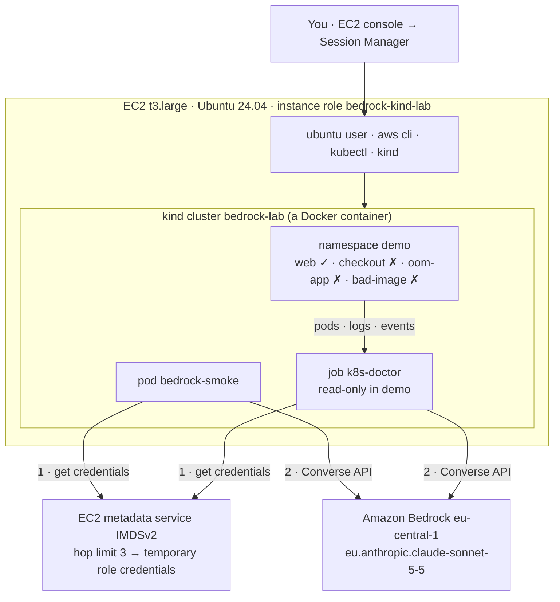

# Bedrock + kind on EC2: basic lab

**What you prove:** a pod inside a kind cluster, running on one EC2 instance, can call
Claude on Amazon Bedrock with **no access keys anywhere**. Then a small "k8s-doctor" job reads
three broken apps and asks Claude what is wrong with them.

> Analogy: the EC2 instance has a staff badge (its IAM role). Pods inside kind borrow that
> badge by asking the building's front desk (the instance metadata service). The badge opens
> exactly one door: Claude on Bedrock.



| Created in AWS | Why |
|---|---|
| IAM role + instance profile `bedrock-kind-lab` | may only invoke `eu.anthropic.claude-sonnet-5-5`; plus Session Manager access |
| Security group `bedrock-kind-lab` | **no inbound rules**, so no SSH port is open |
| EC2 `t3.large`, Ubuntu 24.04, 30 GB gp3 | IMDSv2 required, hop limit 3; user-data installs docker, kind v0.33.0, kubectl v1.37.1, aws cli v2 and copies the lab files |

**Why hop limit 3?** IMDSv2 answers carry a "may be forwarded N times" stamp. A process on the
host needs 1, a plain Docker container 2, and a pod inside kind 3, because the answer travels
host → kind node container → pod. With 1 (a common default) pods get no credentials.

**Cost:** one t3.large for as long as it runs, plus a few Claude calls. Run step 8 when you finish.

---

## Step 1: Launch everything from CloudShell

AWS console, region **Europe (Frankfurt) eu-central-1** → open **CloudShell** →
**Actions → Upload file** → `bedrock-kind-lab.zip`.

```bash
unzip -o bedrock-kind-lab.zip && cd bedrock-kind-lab
bash aws/01-create-ec2.sh
```

It first calls Claude with your own identity, so you see `OK` before anything is created.
If it stops with "not enabled yet", submit the Anthropic use-case form (Bedrock console →
Model catalog → Claude Sonnet 5.5), wait for `AVAILABLE`, and run it again. It ends with
`Instance i-... is running`.

## Step 2: Connect to the instance

EC2 console → **Instances** → `bedrock-kind-lab` → **Connect** → **Session Manager** → **Connect**.
If the button is grey, wait 1–2 minutes.

```bash
sudo su - ubuntu                 # Session Manager logs you in as ssm-user; the lab lives under ubuntu
cloud-init status --wait         # waits for the tool install; expect "status: done"
cat ~/LAB_READY
cd ~/bedrock-kind-lab && ls      # check.sh  k8s  kind-cluster.yaml
```

## Step 3: Check the host can use the role and reach Claude

```bash
aws sts get-caller-identity --query Arn --output text
# arn:aws:sts::<account>:assumed-role/bedrock-kind-lab/i-0123...

# the same credentials, straight from the metadata service
TOKEN=$(curl -s -X PUT http://169.254.169.254/latest/api/token -H "X-aws-ec2-metadata-token-ttl-seconds: 60")
curl -s -H "X-aws-ec2-metadata-token: $TOKEN" http://169.254.169.254/latest/meta-data/iam/info; echo

aws bedrock-runtime converse --model-id "$MODEL_ID" \
  --messages '[{"role":"user","content":[{"text":"Reply with OK"}]}]' \
  --query 'output.message.content[0].text' --output text
# OK
```

## Step 4: Create the kind cluster

```bash
kind create cluster --config kind-cluster.yaml --wait 120s
kubectl get nodes
# bedrock-lab-control-plane   Ready   control-plane   ...   v1.37.0
```

## Step 5: Call Claude from a pod

```bash
kubectl apply -f k8s/01-bedrock-smoke.yaml
kubectl -n bedrock-lab wait pod/bedrock-smoke --for=jsonpath='{.status.phase}'=Succeeded --timeout=240s
kubectl -n bedrock-lab logs bedrock-smoke
```

Expected:

```
identity: arn:aws:sts::<account>:assumed-role/bedrock-kind-lab/i-0123...
claude: A Kubernetes pod is the smallest deployable unit ...
tokens: {'inputTokens': ..., 'outputTokens': ..., 'totalTokens': ...}
BEDROCK SMOKE TEST PASSED
```

The identity line shows the pod is using the **EC2 role**: no Secret, no key in the cluster.

### Optional experiment: see why the hop limit matters

In CloudShell (use your instance id):

```bash
aws ec2 modify-instance-metadata-options --instance-id i-0123... --http-put-response-hop-limit 1 --http-endpoint enabled
```

On the instance, rerun the smoke pod. It fails with `Unable to locate credentials`, because the
host still works but the pod is too many hops away:

```bash
kubectl -n bedrock-lab delete pod bedrock-smoke && kubectl apply -f k8s/01-bedrock-smoke.yaml
kubectl -n bedrock-lab wait pod/bedrock-smoke --for=jsonpath='{.status.phase}'=Failed --timeout=240s
kubectl -n bedrock-lab logs bedrock-smoke | tail -3
```

Set it back to `3` in CloudShell and the pod works again.

## Step 6: Break three apps and let Claude diagnose them

```bash
kubectl apply -f k8s/02-broken-apps.yaml
kubectl -n demo get pods -w
# wait ~2 min: checkout CrashLoopBackOff, oom-app OOMKilled/CrashLoopBackOff,
# bad-image ImagePullBackOff, web Running. Then Ctrl+C.

kubectl apply -k k8s/doctor
kubectl -n bedrock-lab wait --for=condition=complete job/k8s-doctor --timeout=300s
kubectl -n bedrock-lab logs job/k8s-doctor
```

The log shows the **evidence** the doctor collected (pod states, exit codes, limits, logs,
events), then **Claude's diagnosis** per pod: root cause, the evidence line, the fix and a
confidence score. The doctor can only read:

```bash
SA=system:serviceaccount:bedrock-lab:k8s-doctor
kubectl auth can-i list pods -n demo --as=$SA        # yes
kubectl auth can-i get secrets -n demo --as=$SA      # no
kubectl auth can-i delete pods -n demo --as=$SA      # no
```

Run it again after changing something:

```bash
kubectl -n bedrock-lab delete job k8s-doctor && kubectl apply -k k8s/doctor
```

## Step 7: Check every layer with one command

```bash
./check.sh
```

```
1. EC2 host has the instance role
PASS  arn:aws:sts::<account>:assumed-role/bedrock-kind-lab/i-0123...
2. EC2 host can call Claude
PASS  Claude answered: OK
3. kind cluster is up
PASS  bedrock-lab-control-plane   Ready   control-plane ...
4. a pod inside kind can call Claude (pod -> IMDSv2 -> role -> Bedrock)
PASS  pod reached Bedrock with the instance role
5. k8s-doctor diagnoses the broken apps
PASS  Claude diagnosed the namespace (found the OOM)

ALL CHECKS PASSED: kind on EC2 is talking to Amazon Bedrock
```

It stops at the first failing layer and prints the fix, so it also works as a debugging tool.

## Step 8: Clean up

On the instance:

```bash
kind delete cluster --name bedrock-lab
```

In CloudShell, from the `bedrock-kind-lab` folder:

```bash
bash aws/99-cleanup.sh          # terminates the instance, deletes the security group, instance profile and role
```

To pause instead of deleting: `aws ec2 stop-instances --instance-ids i-0123...`. After starting
it again, if `kubectl get nodes` fails, run `docker start bedrock-lab-control-plane`.

---

## Troubleshooting

| Symptom | Fix |
|---|---|
| Step 1 stops: "Claude is not enabled yet" | submit the Anthropic use-case form, wait for `AVAILABLE`, rerun |
| Step 1: "No default VPC" | `aws ec2 create-default-vpc`, rerun |
| Session Manager **Connect** is grey | wait 2 min; the instance needs outbound internet (default VPC has it) |
| `permission denied ... docker.sock` | you are still `ssm-user`: run `sudo su - ubuntu` |
| `kind` or `kubectl` not found | setup not finished: `cloud-init status --wait`; if it says error: `sudo tail -50 /var/log/lab-setup.log` |
| Host `converse` gives `AccessDeniedException` | the model id must be `eu.anthropic.claude-sonnet-5-5` everywhere; re-run `aws/01-create-ec2.sh` to refresh the policy |
| Smoke pod: `Unable to locate credentials` | hop limit too low: in CloudShell `aws ec2 modify-instance-metadata-options --instance-id <id> --http-put-response-hop-limit 3 --http-endpoint enabled` |
| Smoke pod stuck `ContainerCreating` or pip errors | first image pull and pip download take ~1 min; `kubectl -n bedrock-lab describe pod bedrock-smoke` |
| Doctor: `Forbidden` | RBAC missing: `kubectl apply -k k8s/doctor` again |
| Doctor: "No unhealthy pods" | the apps have not failed yet; wait 2 minutes and rerun the job |
| `ThrottlingException` | wait a minute and rerun |

## What this lab simplifies on purpose

Every pod in this kind cluster can reach the metadata service and use the instance role.
That is fine here because the role can only call one Claude model. In a shared cluster you
would block `169.254.169.254` for ordinary pods and give each app its own identity (EKS Pod
Identity on EKS, or a dedicated least-privilege key as in the full `k8s-sre-agent` project).
